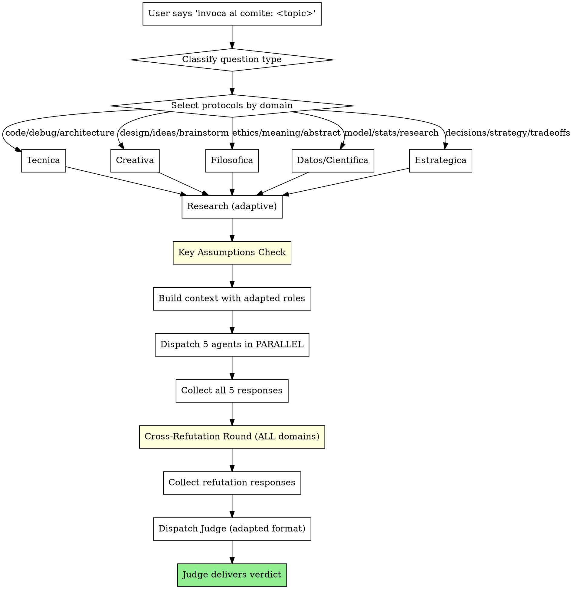
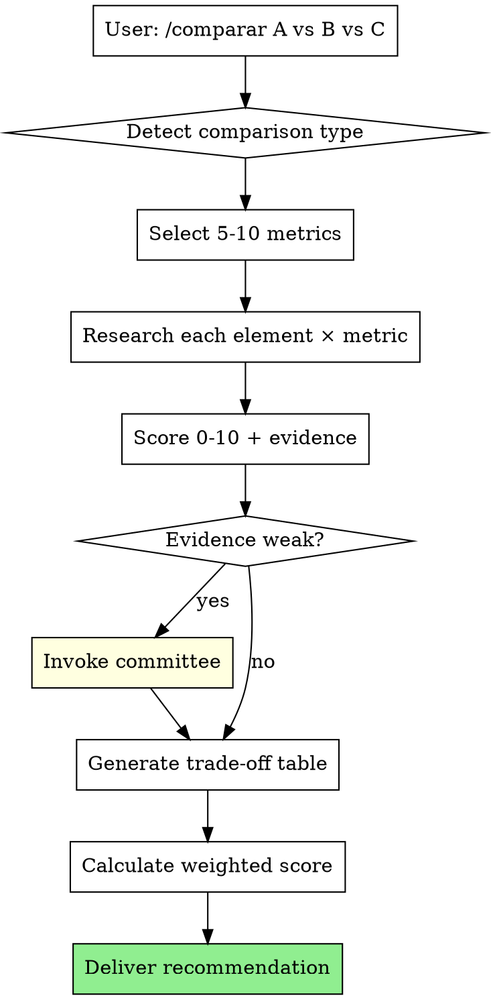

# Committee of Biased Agents

A deliberative committee that analyzes any question or topic through 5 agents with forced opposing biases, followed by a judge who delivers a final verdict taking a clear position.

## Trigger

Activate when the user's message starts with **"invoca al comite:"** (case-insensitive). Everything after the colon is the topic/question to analyze.

## Process



## Step 0: Classify the Question Type

Before anything else, classify the user's question into one of 5 types. This determines agent roles, output format, research strategy, and judge format.

| Type | Keywords / Signals | Examples |
|------|-------------------|----------|
| **Técnica** | "usar", "implementar", "elegir", "comparar", "cómo", "arquitectura", "framework", "lenguaje", "herramienta", "bug", "error", "optimizar" | "¿Microservicios o monolito?", "¿React o Vue?", "¿Cómo optimizar esta query?", "¿Por qué falla este código?" |
| **Creativa** | "diseñar", "crear", "generar", "idear", "concepto", "nombre", "logo", "branding", "historia", "brainstorm" | "Diseña un sistema de recomendación", "Genera ideas para un startup", "Nombre para mi app" |
| **Filosófica** | "¿Qué es?", "¿Por qué?", "sentido", "propósito", "moral", "ético", "consciencia", "realidad", "verdad", "libre albedrío", "después de la vida" | "¿Qué hay después de la muerte?", "¿Es ético el aborto?", "¿Qué es la consciencia?" |
| **Datos/Científica** | "modelo", "dataset", "estadística", "correlación", "hipótesis", "significativo", "predicción", "análisis", "métrica", "accuracy", "tendencia" | "¿Qué modelo usar para predecir churn?", "¿Es significativo este resultado?", "¿Cómo limpiar estos datos?" |
| **Estratégica** | "debería", "vale la pena", "conviene", "mejor", "peor", "riesgo", "oportunidad", "decidir", "cambiar", "invertir" | "¿Debería cambiar de trabajo?", "¿Merece la pena mudarme?", "¿Es buena idea esta inversión?" |

**If ambiguous:** pick the dominant type. If truly mixed, default to **Estratégica** (it's the most general-purpose).

**Output the classification** in the context prompt so agents know their adapted role:

```
[Tipo de pregunta: Técnica]
```

## Step 0.5: Select Protocols by Domain

After classifying, select which analytical protocols apply. This is based on the epistemological structure of each domain — not all techniques transfer equally.

| Domain | Refutación Cruzada | Key Assumptions Check | Criterios de Reversión Pre-Análisis | Rotación de Roles |
|--------|:------------------:|:---------------------:|:-----------------------------------:|:-----------------:|
| **Técnica** | ✅ Always | ✅ Always | ✅ Si asunción incierta ("si esto falla, entonces...") | ⚠️ Only if cross-framework expertise needed |
| **Creativa** | ✅ Always | ✅ Always | ❌ Not applicable | ✅ Always |
| **Filosófica** | ✅ Always | ✅ Always | ✅ Always | ✅ Always |
| **Datos/Científica** | ✅ Always | ✅ Always | ✅ Always | ✅ Always |
| **Estratégica** | ✅ Always | ✅ Always | ✅ Always | ✅ Always |

**Protocol descriptions:**

- **Refutación Cruzada (ALL domains):** After Round 1, each agent receives the other agents' responses and must write a targeted refutation of the strongest argument against their position. This is mandatory for ALL question types. See Step 4.5.

- **Key Assumptions Check (ALL domains):** Before dispatching agents, surface the 3-5 most critical assumptions embedded in the question. Each agent must explicitly state which assumptions they accept and which they challenge. See Step 1.

- **Criterios de Reversión Pre-Análisis (Filosófica/Datos/Estratégica always, Técnica si asunción incierta):** Antes de razonar define "si esto falla, entonces...". Para Técnica: si alguna asunción es [Verificable] e incierta → activa Criterios. Previene razonamiento motivado. Ver Juez.

- **Rotación de Roles (Creativa/Filosófica/Datos/Estratégica):** Agents may be assigned a different persona for Round 2 refutation to force perspective-switching. Not applied in Técnica because domain expertise is required.

**Output the protocol selection:**

```
[Protocolos: Refutación Cruzada | Key Assumptions | Criterios de Reversión | Rotación]
```

## Step 1: Research (Adaptive)

Research strategy adapts to question type:

### Always Research (never skip):

- **Técnica:** search for official docs, benchmarks, comparisons, known issues, community consensus
- **Datos/Científica:** search for papers, case studies, established methodologies, known biases
- **Filosófica:** search for recent studies, expert positions, empirical evidence (NDEs, consciousness research, etc.) — philosophical questions often have factual components
- **Estratégica:** search for data, precedents, case studies, market conditions

### Research Only If Relevant:

- **Creativa:** search for references, trends, successful examples, user research — skip for pure abstract brainstorming

### Research Depth by Type:

| Type | Depth | Focus |
|------|-------|-------|
| Técnica | Deep | Docs, benchmarks, GitHub issues, Stack Overflow consensus, comparison articles |
| Creativa | Light-Medium | References, trends, user research, competitors |
| Filosófica | Medium-Deep | Recent studies, expert positions, empirical data, thought experiments |
| Datos/Científica | Deep | Papers, methodologies, known biases, tool comparisons |
| Estratégica | Medium | Data, precedents, case studies, market conditions |

### Key Assumptions Check (Pre-Analysis)

Before building context, surface the hidden assumptions in the question. This step runs AFTER research and BEFORE agent dispatch.

**Protocol:**
1. List 3-5 critical assumptions embedded in the question or research
2. For each assumption, state: "If this assumption is wrong, then..."
3. Tag each assumption as: [Verificable] (can be tested) or [Unverifiable] (must be accepted/rejected on judgment)
4. Include this list in the context prompt so agents can explicitly challenge or accept each assumption

**Example:**
```
[Key Assumptions Check]
1. "El proyecto tendrá suficiente tráfico para justificar microservicios" → Si es falso, monolito es mejor. [Verificable]
2. "El equipo tiene experiencia con distribución" → Si es falso, la migración falla. [Unverifiable]
3. "Los costos de infraestructura son aceptables" → Si es falso, ROI negativo. [Verificable]
```

**Why this matters:** Every question contains embedded assumptions that all agents will inherit unconsciously. Surfacing them forces explicit engagement and prevents groupthink at the assumption level.

## Step 2: Build Context Prompt with Adapted Roles

After classifying, build the context prompt. Include:

1. **Question type label** — `[Tipo de pregunta: X]`
2. **The topic/question** — exactly as the user stated it
3. **Research findings** (if any)
4. **Adapted agent role instructions** — see Role Adaptation Tables below
5. **Adapted output format** — see Output Formats below

### Role Adaptation by Question Type

#### TÉCNICA

| Agent | Adapted Role | Mandate |
|-------|-------------|---------|
| Pre-mortem | **Root Cause** | "¿Por qué falla/funciona mal? ¿Cuáles son los supuestos ocultos que romperán? ¿Qué dependency va a causar problemas?" |
| Promotor | **Solution Explorer** | "¿Qué alternativas existen? ¿Cuál es la mejor implementación? ¿Qué patterns resolverían esto mejor?" |
| Empírico | **Benchmark** | "¿Qué dice la comunidad? ¿Qué métricas hay? ¿Qué han probado otros? ¿Qué dicen los benchmarks?" |
| Racional | **Architect** | "Trade-offs, escalabilidad, mantenibilidad, first principles de diseño, acoplamiento vs. cohesión" |
| Sintetizador | **Integration** | "¿Qué se está ignorando? ¿Cuál es la recomendación unificada? ¿Qué no han considerado los otros 4?" |

#### CREATIVA

| Agent | Adapted Role | Mandate |
|-------|-------------|---------|
| Pre-mortem | **Devil's Advocate** | "¿Por qué esta idea no funciona? ¿Qué la hace débil? ¿Qué la hace predecible o genérica?" |
| Promotor | **Idea Generator** | "Amplía, mejora, variantes, ángulos no explorados, combinaciones inesperadas" |
| Empírico | **User Voice** | "¿Qué quiere el usuario/audiencia? ¿Qué dice el mercado? ¿Qué ha funcionado antes?" |
| Racional | **Structurer** | "Coherencia, narrativa, estructura, consistencia interna, hilo conductor" |
| Sintetizador | **Concept Fusion** | "Combina lo mejor de cada postura en algo nuevo, encuentra el ángulo que nadie vio" |

#### FILOSÓFICA

| Agent | Adapted Role | Mandate |
|-------|-------------|---------|
| Pre-mortem | **Pre-mortem** | (sin cambios) "La idea ya fracasó — explica por qué cada postura es insostenible" |
| Promotor | **Promotor** | (sin cambios) "La oportunidad existe — explica por qué la postura tiene mérito" |
| Empírico | **Empírico** | (sin cambios) "¿Qué dicen los datos? — evidencia, precedentes, estudios" |
| Racional | **Racional** | (sin cambios) "First principles — cadenas causales, estructura lógica" |
| Sintetizador | **Sintetizador** | (sin cambios) "¿Qué fallan los otros 4? — blind spots, contradicciones, síntesis" |

#### DATOS/CIENCIA

| Agent | Adapted Role | Mandate |
|-------|-------------|---------|
| Pre-mortem | **Data Skeptic** | "¿Qué supuestos hay en los datos? ¿Qué puede estar mal? ¿Qué confounders hay? ¿Qué bias?" |
| Promotor | **Insight Finder** | "¿Qué patrones hay? ¿Qué oportunidades de análisis? ¿Qué variable es la clave?" |
| Empírico | **Methodologist** | "¿Qué método es correcto? ¿Qué métricas? ¿Qué limitaciones? ¿Qué samplesize se necesita?" |
| Racional | **Causal Analyst** | "¿Qué causalidad hay vs. correlación? ¿Qué mecanismos? ¿Qué contrafactuales?" |
| Sintetizador | **Synthesis** | "¿Qué nos dicen los datos en conjunto? ¿Cuál es la narrativa? ¿Qué historia cuentan?" |

#### ESTRATÉGICA

| Agent | Adapted Role | Mandate |
|-------|-------------|---------|
| Pre-mortem | **Pre-mortem** | (sin cambios) "La estrategia ya fracasó — explica por qué" |
| Promotor | **Promotor** | (sin cambios) "La oportunidad es real — explica el upside" |
| Empírico | **Empírico** | (sin cambios) "¿Qué dicen los datos? — evidencia, precedentes" |
| Racional | **Racional** | (sin cambios) "First principles — análisis causal y sistémico" |
| Sintetizador | **Sintetizador** | (sin cambios) "¿Qué fallan los otros 4? — síntesis" |

## Step 3: Dispatch 5 Agents in Parallel

Dispatch all 5 agents simultaneously using the `task` tool. Each agent gets:
- The question type label
- The same context and research
- Their adapted role/persona instructions for this question type
- A constraint: 150-300 words max (200-400 for Técnica/Filosófica), no preamble

**CRITICAL:** All 5 agents must be dispatched in the SAME message (parallel tool calls). They must NOT see each other's responses.

### Output Format Base (Adaptable)

Each agent returns a structured response. The **Postura** and **Confianza** fields are always present. The middle section adapts:

```
## [Rol Adaptado]

**Postura:** [1-2 sentence core position]

**[Sección principal]:** [Contenido adaptado al tipo — ver tablas abajo]

**Puntos débiles de otras perspectivas:** [What other agents might miss]

**Confianza:** [Baja | Media | Alta]
```

**Note:** Each agent file defines its own section names per question type. Use the names specified in the individual agent files, not generic defaults.

## Step 4: Collect Responses

Wait for ALL 5 agents to complete. If any agent fails or times out, note it and proceed with the available responses. The judge will address gaps.

## Step 4.5: Cross-Refutation Round (ALL Domains)

**This step is MANDATORY for ALL question types.** After Round 1, each agent receives ALL other agents' responses and writes a targeted refutation.

**Protocol:**
1. Collect all 5 Round 1 responses
2. For each agent, send them the OTHER 4 agents' responses (not their own)
3. Each agent must:
   - Identify the **single strongest argument** against their position
   - Write a **targeted refutation** (50-100 words max)
   - State whether their position **changes, weakens, or strengthens** based on the challenge
4. All 5 refutations run in PARALLEL (same message, parallel tool calls)

**Refutation Prompt Template:**

```
You are [Agent Name] in Round 2 — Cross-Refutation.

The other 4 agents have responded. Here are their analyses:

[Insert 4 responses here]

YOUR TASK:
1. Find the SINGLE STRONGEST argument against your Round 1 position
2. Refute it directly (50-100 words)
3. State: "Mi postura [se debilita / se mantiene / se fortalece] porque..."

RULES:
- You MUST engage with the SPECIFIC arguments from the other agents, not generic meta-commentary
- If an argument genuinely weakens your position, ADMIT IT — intellectual honesty is more valuable than defending a losing position
- If you change your confidence level, state the new level
- 50-100 words max. No preamble.
```

**Why this matters (per domain):**

| Domain | Why Cross-Refutation Works |
|--------|---------------------------|
| **Técnica** | Detects edge cases the author missed; validates assumptions against counter-examples |
| **Creativa** | Forces engagement with alternatives; prevents premature attachment to one idea |
| **Filosófica** | Exposes logical inconsistencies between positions; forces engagement with strongest counterarguments |
| **Datos/Científica** | Challenges methodology and interpretation; surfaces confounders others missed |
| **Estratégica** | Tests strategic assumptions against opposing views; surfaces blind spots |

**After Round 2:** The Judge receives BOTH Round 1 AND Round 2 (refutation) responses.

## Step 5: Dispatch the Judge (Adapted Format)

The judge receives ALL 5 agent responses from Round 1 AND Round 2 (refutations), plus the question type. The judge format adapts:

### Judge Adaptation by Type:

| Type | Judge Focus | Extra Section |
|------|------------|---------------|
| Técnica | Recomendación accionable con implementación | **Implementación** (código/pasos concretos) |
| Creativa | Elegir o combinar conceptos, dirección creativa | **Dirección Creativa** (qué concepto seguir) |
| Filosófica | Posición clara con razonamiento (actual) + **Criterios de Reversión** | **Criterios de Reversión** (qué evidencia cambiaría esta postura) |
| Datos/Científica | Conclusión + próximos pasos analíticos + **Criterios de Reversión** | **Próximos Pasos** + **Criterios de Reversión** |
| Estratégica | Decisión clara con criterios de reversión | **Criterios de Reversión** (cuándo cambiar de opinión) |

**Note:** For Filosófica, Datos/Científica, and Estratégica, the Judge MUST include reversal criteria — "what evidence would change this verdict?" This prevents motivated reasoning in open-domain questions.

### Judge Cross-Refutation Analysis

The judge must also evaluate the Round 2 refutations:

**In the Evaluación de Posturas table, add a column:**

| Postura | Fortaleza | Debilidad | Cambio tras Refutación |
|---------|-----------|-----------|----------------------|
| [Agent 1] | ... | ... | [Se mantuvo / Se debilitó / Se fortaleció / Cambió de posición] |

**In the Consensos section, add:**

**Refutaciones más efectivas:** [Which agent's refutation most changed the analysis, and why]

**Posiciones que sobrevivieron:** [Which agents' positions held firm under challenge, and why]

### Judge Output Format

```
## Veredicto del Comité

### Evaluación de Posturas

| Postura | Fortaleza | Debilidad | Cambio tras Refutación |
|---------|-----------|-----------|----------------------|
| [Agente 1] | ... | ... | [Se mantuvo / Se debilitó / Se fortaleció / Cambió] |
| [Agente 2] | ... | ... | [Se mantuvo / Se debilitó / Se fortaleció / Cambió] |
| [Agente 3] | ... | ... | [Se mantuvo / Se debilitó / Se fortaleció / Cambió] |
| [Agente 4] | ... | ... | [Se mantuvo / Se debilitó / Se fortaleció / Cambió] |
| [Agente 5] | ... | ... | [Se mantuvo / Se debilitó / Se fortaleció / Cambió] |

### Consensos y Conflictos

**Donde hay acuerdo:** [areas of convergence]

**Donde hay conflicto:** [key disagreements and why]

**Refutaciones más efectivas:** [Which agent's refutation most changed the analysis]

**Posiciones que sobrevivieron:** [Which agents held firm under challenge]

### Mi Veredicto

**Respuesta directa:** [DIRECT answer to the original question]

**Razonamiento:** [Why this position — addressing strongest counterarguments]

[Sección extra adaptada al tipo — ver arriba]

**Matiz:** [Caveats, conditions, what could change this verdict]
```

## v3 Mejora Standard — 2026-10-21 — Agente Contrato + Linter Fino (+400 tok)
Standard v3 mantiene 5 agentes +1 refutación + juez (~11270 tok, +400) y añade: **Fase 0.5 Agente Contrato** (valida contrato vs harness: métrica invertida, split fantasma, cláusula venenosa, SchemaStrict) + **Root Cause mejorado a linter taxonómico 12 micro-patrones** (equivoco/anfibología/cuantificador/non-sequitur/petición principio/falso dilema/pendiente/contradicción diacrónica/warrant implícito/presuposición framing/alcance modal/inconsistencia grounds-claim) con severidad 1-3 + cita textual + por qué falla warrant + reescritura mínima + **Toulmin lite** (Claim-Grounds-Warrant por paso) + **gateway 2 niveles** (L1 determinista NLI+regex+embedding score 0-9; L2 LLM solo si ≥4) + mutación acotada ∀↔∃ y debe→puede. Objetivo V9 0/5→3/5 sin subir a PRO. v2 sigue documentado como fallback sin contrato.

## v4 Sargento Anti-Trampas — 2026-10-21 — Guardrail transversal (ambos comités)
Sargento NO es 6º deliberante, es guardrail pre-juez + auditor. Verifica 5 vectores: hardcodeo (if input==expected), simulación sin ejecución, tokens hardcodeados (comiteTok literal), harness permeable (sin hash), proof falso. **Además audita tests del workflow que verifican éxito de cada tarea (harness L1/L2 de cada step) en busca de deficiencias, trampas e ineficiencias** — bloquea `assert True`, `toBeTruthy` sin valor, mocks que sustituyen lógica, `skip/todo` y snapshots vacíos. Herramientas: harness hermético (docker --network none, seed fijo), reproductor (re-ejecuta código+comando y compara hash), canario (input oculto). **Standard modo ligero no bloqueante** (~+150 tok, veto blando etiqueta amarilla): 1 canario + tríada código+comando+artefacto. **PRO modo estricto bloqueante** (~+400 tok, veto duro): 2 canarios + reproductor + inquisidor adversarial. Si veta, bloquea veredicto y obliga re-deliberación. Decisión por reproducción determinista, no por LLM.

## v5 Parches prompt sin +tokens — 2026-10-21 — Endurece sin engordar (neto -11 tok)
**P1** Sustituye prohibición negativa por regla positiva: `Serializa con stableKey: sort keys ASCII, stringify determinista.` (0 tok). **P2** Enriquece ejemplo canónico inline: `// BigInt->string, signal: AbortSignal throwIfAborted` (+6 tok std/+9 pro). **P3** Checklist Pareto inline reemplaza párrafo verbose: `Check: [1] keys ordenadas [2] tokens continuos [3] cancelable.` (-8 tok). **P4** Poda 2 principios redundantes (-15 tok). Neto -11/-14 tok, sin nuevo few-shot.

## Rules

1. **Language:** Respond in the SAME language the user used to invoke the committee
2. **No fence-sitting:** The judge MUST take a clear position. "It depends" is not a verdict
3. **No preamble:** Agents jump directly into analysis. No "Great question!" or "Let me think..."
4. **Time-boxed:** Each agent has 150-300 words (200-400 for Técnica/Filosófica). Refutations: 50-100 words. The judge has up to 800 words
5. **Topic agnostic:** This works for ANY topic — the classification adapts the approach
6. **Respect the biases:** Agents must fully embody their adapted role, not hedge
7. **The judge reads ALL:** Even if one agent fails, the judge works with what's available
8. **Adapt, don't force:** If an agent's role doesn't perfectly fit the question, adapt gracefully — the role label is a lens, not a straitjacket
9. **Cross-Refutation is mandatory:** Every domain gets Round 2. No exceptions. The refutation step is not optional — it is the core anti-complacence mechanism
10. **Intellectual honesty in refutation:** If a refutation genuinely weakens an agent's position, the agent MUST acknowledge it. Defending a losing position is worse than changing your mind
11. **Protocol selection is automatic:** The system selects protocols based on domain. Don't override — the epistemological structure of the domain determines what works
12. **Key Assumptions Check is non-negotiable:** Every question gets surfaced assumptions. This prevents inheriting hidden biases from the question itself

## Example Usage

```
User: invoca al comite: quien crees que va a ganar el mundial 2026?

→ Type: Datos/Científica
→ Research: FIFA rankings, qualified teams, key players, friendlies, historical performance data
→ Adapted roles: Data Skeptic (fatigue, injuries, sample bias), Insight Finder (key stats, patterns), Methodologist (what metrics predict World Cup winners?), Causal Analyst (tactical vs. talent vs. draw), Synthesis (unified prediction)
→ Judge: clear prediction with reasoning and methodology
```

```
User: invoca al comite: deberia usar microservicios para mi proyecto?

→ Type: Técnica
→ Research: microservices vs monolith benchmarks, case studies, known issues
→ Adapted roles: Root Cause, Solution Explorer, Benchmark, Architect, Integration
→ Judge: recommendation with implementation guidance
```

```
User: invoca al comite: que hay despues de la vida?

→ Type: Filosófica
→ Research: NDE studies (Parnia AWARE), consciousness research, cultural beliefs data
→ Adapted roles: standard philosophical agents (no changes)
→ Judge: clear position with nuance
```

```
User: invoca al comite: que modelo debo usar para predecir churn?

→ Type: Datos/Científica
→ Research: churn prediction benchmarks, model comparisons, feature engineering best practices
→ Adapted roles: Data Skeptic, Insight Finder, Methodologist, Causal Analyst, Synthesis
→ Judge: model recommendation with methodology
```

```
User: invoca al comite: dame ideas para un nombre de mi app de fitness

→ Type: Creativa
→ Research: naming trends in fitness apps, memorable app names, user preferences
→ Adapted roles: Devil's Advocate, Idea Generator, User Voice, Structurer, Concept Fusion
→ Judge: top name recommendations with rationale
```

---

# Comparison Workflow (`/comparar`)

A structured comparison workflow that evaluates 2+ elements using weighted metrics, evidence-based scoring, and trade-off analysis. Can invoke the committee for deep research when evidence is ambiguous.

## Trigger

Activate when the user's message starts with **"/comparar"** (case-insensitive). Everything after the slash is the comparison input.

**Format:** `/comparar <elemento1> vs <elemento2> [vs <elemento3>...]`

**Examples:**
- `/comparar React vs Vue vs Angular`
- `/comparar AWS vs Azure vs GCP`
- `/comparar estrategias de pricing: freemium vs subscription vs usage-based`
- `/comparar modelos de ML: random forest vs xgboost vs neural networks`

## Comparison Flow



## Step 0: Detect Comparison Type

Classify the comparison into a domain. This determines which metric catalog to use.

| Type | Signals | Examples |
|------|---------|----------|
| **Framework/Tool** | "framework", "lib", "herramienta", "tech stack" | React vs Vue, Django vs Flask |
| **Platform/Service** | "cloud", "hosting", "SaaS", "platform" | AWS vs Azure, Stripe vs PayPal |
| **Language** | "lenguaje", "language", "programming" | Python vs Go, Rust vs C++ |
| **Strategy** | "estrategia", "approach", "modelo" | freemium vs subscription |
| **ML/Data** | "modelo", "algoritmo", "dataset" | random forest vs xgboost |
| **Concept** | "concepto", "idea", "enfoque" | microservices vs monolith |

**Output the classification:**
```
[Tipo de comparación: Framework/Tool]
```

## Step 1: Select Metrics

Dispatch the **metric-selector** agent. It reads `metric-catalog.md` for the detected domain and selects 5-10 relevant metrics.

Each metric gets:
- **Name** — clear, unambiguous
- **Weight** (1-3) — importance for this specific comparison
- **Justification** — why this metric matters here
- **Source type** — where to find evidence (benchmarks, docs, community, pricing pages)

If the domain is not in the catalog, the agent generates metrics from first principles.

**Output:**
```
### Métricas seleccionadas (N)

| # | Métrica | Peso | Justificación | Fuente |
|---|---------|------|---------------|--------|
| 1 | ... | 3 | ... | benchmarks |
| 2 | ... | 2 | ... | documentación |
| ... | ... | ... | ... | ... |
```

## Step 2-3: Research + Score

Dispatch the **research-analyst** agent. For each metric × element combination:

1. **Research** — find evidence (web search, docs, benchmarks, pricing pages)
2. **Score** — assign 0-10 based on evidence
3. **Link evidence** — attach source URL or data point
4. **Flag confidence** — strong (3+ sources), medium (1-2 sources), weak (no source)

**Output per cell:**
```
| Métrica | Elemento A | Elemento B |
| Precio | 8 (USD 9/mes [fuente]) | 5 (USD 29/mes [fuente]) |
```

**Evidence strength flag:**
```
[evidence_summary]
Rendimiento: strong (3 benchmarks)
Precio: strong (official pricing pages)
Comunidad: medium (GitHub stars only)
Seguridad: weak (no verifiable data) ← WILL TRIGGER COMMITTEE
```

## Step 4: Committee Invocation (Conditional)

**This step is OPTIONAL.** It triggers when:

| Condition | Action |
|-----------|--------|
| ≥2 metrics with `weak` evidence | Invoke committee for those metrics only |
| Conflicting sources (A says X, B says Y) | Invoke committee to debate |
| User explicitly requests | Always honor |

**How it works:**
1. Identify the metrics with weak/conflicting evidence
2. Invoke the committee with a focused question: *"¿Qué métricas son relevantes para comparar [X] y [Y] en el dominio [Z]?"*
3. The committee's response feeds into the scoring
4. The comparison output notes: *"Se invocó al comité para validar [métricas]"*

**If committee is NOT invoked:** proceed directly to Step 5.

## Step 5: Generate Trade-off Table

Dispatch the **comparison-juez** agent. It produces:

### Trade-offs
```
**[Elemento A] gana en:** [lista de métricas donde gana, con diferencia]
**[Elemento B] gana en:** [lista de métricas donde gana, con diferencia]
**Empate en:** [métricas donde la diferencia es ≤1 punto]
```

### Sensitivity Analysis
```
¿Cambia el ganador si [métrica X] pesa el doble?
- Si "Precio" sube de peso 2 → 4: [Elemento B] gana
- Si "Rendimiento" sube de peso 2 → 4: [Elemento A] mantiene ventaja
```

## Step 6: Final Score + Recommendation

### Weighted Score Calculation
```
Score = Σ (score_i × weight_i) / Σ (weight_i)
```

**Output:**
```
### Score final (ponderado)

| Elemento | Score | Rank |
|----------|-------|------|
| [A] | X.X | #1 |
| [B] | X.X | #2 |
| [C] | X.X | #3 |
```

### Contextual Recommendation

The judge produces a recommendation based on the user's likely context:

```
### Recomendación

**Para tu caso:** [context detected from the comparison]

- **Si priorizas [X]:** Elige [Elemento A] — [reason]
- **Si priorizas [Y]:** Elige [Elemento B] — [reason]
- **Si necesitas [Z]:** Elige [Elemento C] — [reason]
```

## Comparison Output Format

The complete output follows this structure:

```
## Comparativa: [A] vs [B] vs [C]

**Tipo detectado:** [Domain]
**Elementos:** [List]

### Métricas seleccionadas (N)

| # | Métrica | Peso | Justificación | Fuente |
|---|---------|------|---------------|--------|
| ... | ... | ... | ... | ... |

### Tabla comparativa

| Métrica (peso) | [A] | [B] | [C] |
|----------------|-----|-----|-----|
| ... | ... | ... | ... |

### Notas por métrica

| Métrica | Nota | Aplica a |
|---------|------|----------|
| [Metric] | [Contexto, caveat, advertencia o condición] | [Elemento / Todos] |

### Trade-offs

**[A] gana en:** ...
**[B] gana en:** ...
**Empate en:** ...

### Score final (ponderado)

| Elemento | Score | Rank |
|----------|-------|------|
| ... | ... | ... |

### Análisis de sensibilidad
- Si [métrica] pesa el doble: [resultado]

### Recomendación
**Para tu caso:** [contextual recommendation with alternatives]

### Evidencia detallada
[URLs, datos específicos, benchmarks por celda]
```

## Rules for Comparison Flow

1. **Language:** Respond in the SAME language the user used
2. **No scores without evidence:** Every 0-10 score MUST have a linked source. "No data" is a valid finding — score it as N/A, not 0
3. **Weights are contextual:** Same metrics get different weights for different comparisons. "Precio" weighs more for startups than enterprises
4. **Trade-offs > final score:** The trade-off table is MORE important than the average. Always present both
5. **Sensitivity analysis is mandatory:** Always check if the winner changes when weights shift
6. **Committee invocation is advisory:** When the comparison invokes the committee, the committee's output INFORMS the comparison — it doesn't replace it
7. **Minimum 2 elements:** If user provides only 1 element, ask for the second. If they can't provide one, suggest common alternatives
8. **Maximum 5 elements:** Beyond 5, the table becomes unreadable. Suggest splitting into sub-comparisons
9. **Evidence freshness:** Prefer data from the last 12 months. Flag older data explicitly
10. **N/A is valid:** If a metric doesn't apply to an element (e.g., "precio" for open-source), mark it as "N/A" — don't force a score

## Directory Structure

```
committee/
├── SKILL.md                 (this file — both workflows)
├── metric-catalog.md        (metric templates by domain)
└── agents/
    ├── pre-mortem.md        (committee: adapted roles per type)
    ├── promotor.md          (committee: adapted roles per type)
    ├── empirico.md          (committee: adapted roles per type)
    ├── racional.md          (committee: adapted roles per type)
    ├── sintetizador.md      (committee: adapted roles per type)
    ├── juez.md              (committee: verdict format per type)
    ├── metric-selector.md   (comparison: metric selection)
    ├── research-analyst.md  (comparison: research + scoring)
    └── comparison-juez.md   (comparison: trade-offs + recommendation)
```
